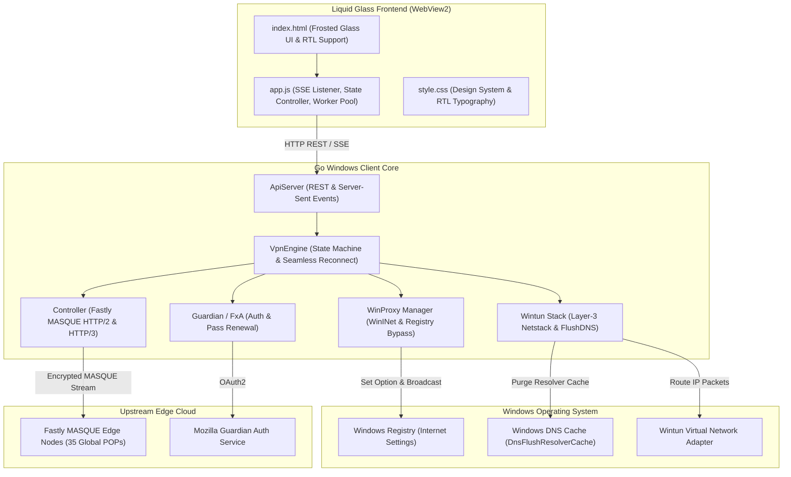

# FYRNOX Architecture & Design Specification
# مستندات معماری و مشخصات فنی کلاینت FYRNOX

---

## 🇬🇧 English: System Architecture

### Component Breakdown
1. **Frontend Layer:**
   - Embedded Microsoft Edge WebView2 frameless window with Win32 message interceptors for dragging and sizing (`window_windows.go`).
   - Dynamic i18n localization engine supporting English (`en-US`) and Persian (`fa-IR`) with full RTL styles.
   - Real-time Server-Sent Events (SSE) `/api/events` delivering millisecond telemetry for traffic counters, connection duration, and exit probe transparency.

2. **Core Engine Layer:**
   - Multi-state finite state machine (`disconnected`, `connecting`, `connected`, `disconnecting`, `error`).
   - Seamless hot-reconnection controller automatically rotating upstream tunnels on user server selection without interrupting UI threads.
   - Built-in anti-censorship engine utilizing TLS ClientHello fragmentation (`sni` and `first_byte` strategies) to bypass deep packet inspection (DPI).

3. **Networking & Routing Subsystems:**
   - **System Proxy Mode (Default):** Dual HTTP (`20809`) and SOCKS5 (`20808`) local listeners. Registry-level WinINet hooks with zero-latency `InternetSetOptionW` refreshes, remote DNS resolution, and local subnet bypass rules.
   - **Wintun TUN Mode (Optional Admin):** Direct L3 kernel virtual network adapter routing 100% of Windows UDP/TCP packets into a gVisor network stack (`tun2socks/v2`). Includes automatic physical gateway discovery and explicit route bindings.

---

## 🇮🇷 فارسی: معماری فنی سیستم

### ساختار کلی سیستم
کلاینت دسکتاپ FYRNOX از ترکیب سه لایه اصلی تشکیل شده است:
۱. **لایه واسط کاربری (UI):** محیط گرافیکی مدرن شیشه‌ای مبتنی بر موتور تعبیه‌شده WebView2 مایکروسافت بدون فریم بومی ویندوز که توسط توابع سفارشی Win32 مدیریت می‌شود. این لایه مجهز به سیستم دوزبانه بلادرنگ و پشتیبانی کامل از چینش راست‌به‌چپ (RTL) است.
۲. **لایه هسته مهندسی گو (Go Core Engine):** ماشین وضعیت اتصال، موتور احراز هویت با موزیلا گاردین، سوییچ خودکار و بی‌وقفه سرورها (Hot-Reconnect)، و موتور ضدفیلترینگ تکه‌تکه‌سازی پکت‌های TLS ClientHello.
۳. **زیرسیستم شبکه ویندوز (Windows Networking):** دو حالت مستقل مسیریابی شامل پراکسی سیستمی ویندوز (WinINet) با قوانین دور زدن شبکه محلی، و حالت پیشرفته درایور هسته Wintun جهت هدایت کل بسته‌های لایه ۳ و بازی‌ها.

---

## 📄 ردیاب مسائل و توسعه (Issue Tracking)
کلیه گزارش‌های مربوط به توسعه و نسخه‌ها در ردیاب رسمی گیت‌هاب ثبت می‌گردند:  
[GitHub Issue #1](https://github.com/yousefkiamozafari/FYRNOX/issues/1) | [`docs/issues/ISSUE_v1.0.4_OVERHAUL.md`](issues/ISSUE_v1.0.4_OVERHAUL.md)
