# FYRNOX Technical Investigation Report: Mozilla Guardian HTTP 401 Authentication Failure

- **Document Version:** 1.0.0
- **Status:** Complete / Read-Only Audit & Comparative Architecture Analysis
- **Target Repository:** `yousefkiamozafari/FYRNOX` (`C:\Users\Yousef Kia\Desktop\FYRNOX`)
- **Reference Implementation:** `armanlife/arman-vpn-client` (`https://github.com/armanlife/arman-vpn-client`)
- **Target Symptom:** `Failed to get proxy pass: token invalid (HTTP 401): {"error":"Unauthorized"}`

---

## Table of Contents

1. [Executive Summary](#1-executive-summary)
2. [Phase 1: Workspace & Repository Verification](#2-phase-1-workspace--repository-verification)
3. [Phase 2: Complete Authentication & Token Lifecycle Comparison](#3-phase-2-complete-authentication--token-lifecycle-comparison)
4. [Phase 3: Deep Technical Analysis of the HTTP 401 Failure](#4-phase-3-deep-technical-analysis-of-the-http-401-failure)
5. [Phase 4: Rigorous Separation of Error Classes](#5-phase-4-rigorous-separation-of-error-classes)
6. [Phase 5: Comprehensive Architecture Comparison Table](#6-phase-5-comprehensive-architecture-comparison-table)
7. [Root Cause Classification: Facts, Hypotheses & Assumptions](#7-root-cause-classification-facts-hypotheses--assumptions)
8. [Minimal Safe Implementation Plan](#8-minimal-safe-implementation-plan)
9. [Test & Verification Strategy](#9-test--verification-strategy)

---

## 1. Executive Summary

### 1.1 Problem Statement
When connecting to the VPN or refreshing quota/entitlement status, FYRNOX surfaces the following user-facing failure:

```text
Failed to get proxy pass: token invalid (HTTP 401): {"error":"Unauthorized"}
```

This error originates in `cmd/fyrnox/engine.go:1326` when `getOrRenewProxyPass` fails to negotiate a valid JSON Web Token (`ProxyPassInfo`) from the Mozilla Guardian control-plane service (`GET https://vpn.mozilla.org/api/v1/fpn/token`).

### 1.2 Primary Findings & Root Causes
A thorough comparative audit of FYRNOX against `armanlife/arman-vpn-client` identified four interconnected architectural defects responsible for this failure:

1. **Dead Token Freshness Logic (Stale Access Token Dispatch):**
   Although `tokens.go` defines `SavedTokens.AccessTokenValid()` and `cmd/fyrnox/core.go` defines `runtimeAuth.accessTokenValid(now time.Time)`, **neither check is ever called** prior to invoking `vpnclient.FetchProxyPass` in `cmd/fyrnox/engine.go`. When saved credentials exceed their 24-hour expiration (`ExpiresIn: 86400`), FYRNOX transmits an expired Bearer token directly to Guardian, prompting an immediate `HTTP 401 {"error":"Unauthorized"}`.

2. **Inverted and Broken Error Recovery (401 vs 403 Conflation):**
   In `guardian.go:107-109`, FYRNOX maps both HTTP 401 (Unauthorized) and HTTP 403 (Forbidden) into the exact same error: `ErrTokenInvalid`. In response, `getOrRenewProxyPass` immediately attempts `ActivateGuardian` (`POST /api/v1/fpn/activate`) with the **same rejected access token**. This guaranteed-to-fail secondary call burns network latency and generates a second HTTP 401 error.

3. **Masked Refresh Token Failures (Error Shadowing):**
   If the subsequent call to `vpnclient.FxaRefreshToken` fails (due to an empty/revoked refresh token, network timeout, edge anti-bot challenge, or upstream rejection), `getOrRenewProxyPass` logs a warning and falls through to return the **original** `ErrTokenInvalid (HTTP 401)`. The user is told the token is unauthorized, masking the true underlying failure that the refresh token was expired, missing, or rejected.

4. **Fingerprinting & Edge Mismatch:**
   FYRNOX sends Chrome 126 desktop User-Agent headers over standard Go `crypto/tls` negotiating HTTP/2 to Mozilla's FxA and Guardian APIs. In contrast, Arman VPN uses exact Firefox desktop User-Agent strings, uTLS Firefox ClientHello fingerprints, `Accept-Encoding: identity`, and forces HTTP/1.1 on the control plane to evade Fastly bot filtering and protocol anomalies.

---

## 2. Phase 1: Workspace & Repository Verification

### 2.1 Workspace Integrity
- **Local Path:** `C:\Users\Yousef Kia\Desktop\FYRNOX`
- **Git Origin:** `https://github.com/yousefkiamozafari/FYRNOX.git`
- **Active Branch:** `main` (verified clean working tree, up to date with origin/main)
- **HEAD Commit:** `a41d242` (`chore(release): bump version to v1.0.5, update documentation and build artifacts`)

### 2.2 Component State in FYRNOX
- `fxa.go`: Implements PBKDF2/HKDF password stretching, Hawk v1 header authentication, Fastly challenge solving retry loop, and OAuth endpoints.
- `guardian.go`: Implements `FetchProxyPass`, `FetchUserInfo`, `ActivateGuardian`, and JWT claim decoding. Conflates HTTP 401 and HTTP 403.
- `tokens.go`: Implements atomic token persistence to `.firefox-vpn-tokens.json` with file permissions 0600. Contains `AccessTokenValid()` and `RefreshAndSaveTokens()`.
- `http_client.go`: Provides isolated `controlPlaneHTTPClient` with cookie jar and HTTP/2 transport.
- `http_headers.go`: Sets `fastlySolverUserAgent` (Chrome 126) and `Accept: application/json`.
- `cmd/fyrnox/engine.go`: Orchestrates token loading, `getOrRenewProxyPass`, account activation, and UI state reporting.

---

## 3. Phase 2: Complete Authentication & Token Lifecycle Comparison

The table below contrasts the 8 phases of the authentication lifecycle between FYRNOX and the reference Arman VPN implementation:

```mermaid
flowchart TD
    subgraph FYRNOX_Flow["FYRNOX Current Flow"]
        F1["Load Saved Tokens"] --> F2{"Check Access Token Expiry?"}
        F2 -- "NO (Bypassed)" --> F3["GET /api/v1/fpn/token<br/>(Bearer Access Token)"]
        F3 -- "HTTP 401 Unauthorized" --> F4["Conflate 401/403 into ErrTokenInvalid"]
        F4 --> F5["POST /api/v1/fpn/activate<br/>(With SAME Rejected Token!)"]
        F5 -- "Fails (HTTP 401)" --> F6["POST /v1/oauth/token<br/>(FxaRefreshToken)"]
        F6 -- "Fails or Times out" --> F7["Swallow Refresh Error<br/>Return Original HTTP 401"]
    end

    subgraph Arman_Flow["Arman VPN Reference Flow"]
        A1["Load Stored Account"] --> A2{"FreshRuntimeAuth?<br/>(accessTokenValid)"}
        A2 -- "Expired / Expiring" --> A3["fxa.RefreshToken<br/>(Primary + Alt Endpoint)"]
        A2 -- "Fresh" --> A4["GET /api/v1/fpn/token<br/>(Firefox Headers + uTLS)"]
        A3 --> A4
        A4 -- "HTTP 401" --> A5["Distinguish 401 from 403<br/>Immediate RefreshRuntimeAuth"]
        A4 -- "HTTP 403" --> A6["Account Not Entitled<br/>Call guardian.Activate"]
        A5 --> A4
        A6 --> A4
    end
```



### Detailed Stage Breakdown:

1. **Firefox Account Login (`fxaLogin`):**
   - **FYRNOX:** Computes `authPW` using PBKDF2 (1,000 rounds) and HKDF-SHA256 (`picl/v1/quickStretch` & `authPW`). Posts JSON to `https://api.accounts.firefox.com/v1/account/login` with `verificationMethod: email-2fa`. Falls back to plain login if errno 107.
   - **Arman VPN:** Identical cryptographic stretching, but also handles errno 120 (`fxaErrnoIncorrectEmailCase`) by extracting the canonical account email casing and retrying automatically.

2. **Session Token Creation & Verification Status:**
   - **FYRNOX:** Checks `loginResp.Verified`. If false, saves `pendingSessionToken` and awaits 2FA email code via `fxaVerifySession`. However, if the user signs in with a pre-existing session token (`LoginWithSessionToken`), FYRNOX assumes it is verified without checking.
   - **Arman VPN:** Explicitly inspects `SessionVerified` against `GET /recovery_email/status` with Hawk authentication to confirm verification status prior to OAuth exchange.

3. **Hawk Credential Derivation:**
   - **FYRNOX & Arman VPN:** Both correctly derive Hawk credentials via HKDF-SHA256 with info `identity.mozilla.com/picl/v1/sessionToken`. Both generate RFC 5849 / Hawk Authorization headers with timestamp, 6-byte random nonce, and payload SHA-256 hash.

4. **OAuth Access Token Issuance:**
   - **FYRNOX:** Posts to `https://api.accounts.firefox.com/v1/oauth/token` with `grant_type: fxa-credentials`, `client_id: 5882386c6d801776`, and `scope: profile https://identity.mozilla.com/apps/vpn`.
   - **Arman VPN:** Same primary credentials grant, but adds `exchangeSessionWithOAuthCode` fallback: if direct exchange is challenged (HTTP 406), it requests an authorization code via PKCE (`POST /oauth/authorization` with `code_challenge_method: S256`) and exchanges it at `https://oauth.accounts.firefox.com/v1/token`. Additionally, calls `DestroySession` to prevent orphaned sessions in FxA.

5. **OAuth Refresh Token Renewal:**
   - **FYRNOX:** Sends `grant_type: refresh_token` only to `https://api.accounts.firefox.com/v1/oauth/token`. If that fails, it has no alternate route.
   - **Arman VPN:** Sends to `https://api.accounts.firefox.com/v1/oauth/token` and seamlessly falls back to `https://oauth.accounts.firefox.com/v1/token` (`refreshAtOAuthEndpoint`) on HTTP 406 or edge refusals.

6. **Token Persistence & Expiry Tracking:**
   - **FYRNOX:** Writes `.firefox-vpn-tokens.json` atomically with permissions 0600. Includes `ObtainedAt` and `ExpiresIn`. Defines `AccessTokenValid()`, but **does not invoke it** in the connection pipeline.
   - **Arman VPN:** Encapsulates credentials in `runtimeAuth`. Provides `FreshRuntimeAuth()`, guaranteeing an access token is never sent across the network if `now.After(ObtainedAt + ExpiresIn - 2min)`.

7. **Guardian Entitlement & Activation:**
   - **FYRNOX:** Conflates HTTP 401 and 403. Calls `ActivateGuardian` (`POST /api/v1/fpn/activate`) on 401 errors using an already rejected token.
   - **Arman VPN:** Strictly separates HTTP 401 (`ErrTokenInvalid`) from HTTP 403 (`ErrNotEntitled`). Calls `Activate` **only** on HTTP 403.

8. **Guardian Proxy Pass Issuance:**
   - **FYRNOX:** `GET https://vpn.mozilla.org/api/v1/fpn/token` with `Authorization: Bearer <accessToken>`. Parses JWT payload to extract claims (`sub`, `aud`, `iat`, `nbf`, `exp`, `iss`). Reads `X-Quota-*` headers.
   - **Arman VPN:** Same endpoint, but adds `Cache-Control: max-age=0`, `Accept: */*`, `Accept-Encoding: identity`, Firefox User-Agent, uTLS handshake, and claims time anchoring.

---

## 4. Phase 3: Deep Technical Analysis of the HTTP 401 Failure

### 4.1 Exactly Which Credential is Rejected?
The credential rejected with `HTTP 401 Unauthorized: {"error":"Unauthorized"}` is the **OAuth Access Token** transmitted in the request header:

```http
GET /api/v1/fpn/token HTTP/1.1
Host: vpn.mozilla.org
Authorization: Bearer <accessToken>
Accept: application/json
```

Mozilla Guardian's authentication gateway validates this Bearer token against the Firefox Accounts OAuth introspection backend. The token is rejected if:
- The token lifetime (typically 24 hours / 86400 seconds) has elapsed.
- The token was revoked upstream (e.g. user signed out, logged in on another device, or altered account security credentials).
- The token lacks the required audience or scope (`https://identity.mozilla.com/apps/vpn`).
- The session was destroyed or marked invalid in the FxA database.

### 4.2 Comprehensive Parameter Comparison Table

| Parameter | FYRNOX Implementation | Arman VPN Reference | Impact / Significance |
| :--- | :--- | :--- | :--- |
| **OAuth Client ID** | `5882386c6d801776` (`fxa.go:24`) | `5882386c6d801776` (`fxa.go:25`) | **Identical.** Both use the standard official Firefox Desktop client ID. |
| **OAuth Scope** | `profile https://identity.mozilla.com/apps/vpn` | `profile https://identity.mozilla.com/apps/vpn` | **Identical.** Both request proper profile and VPN scopes. |
| **Grant Types** | `fxa-credentials` (initial), `refresh_token` (renewal) | `fxa-credentials`, `refresh_token`, PKCE `authorization_code` | **Deficiency in FYRNOX.** Lack of PKCE code fallback leaves FYRNOX vulnerable if direct credential exchange is challenged. |
| **OAuth Endpoints** | Only `api.accounts.firefox.com/v1/oauth/token` | `api.accounts.firefox.com/v1/oauth/token` and `oauth.accounts.firefox.com/v1/token` | **Deficiency in FYRNOX.** Arman VPN can fall back to the dedicated OAuth domain if the API subdomain fails. |
| **Pre-Request Freshness Check** | `AccessTokenValid()` exists but is **NEVER CALLED** in `engine.go` | `FreshRuntimeAuth()` called prior to every Guardian request | **CRITICAL DEFECT IN FYRNOX.** Guarantees HTTP 401 when starting FYRNOX with saved tokens older than 24 hours. |
| **Error Code Disambiguation** | Conflates HTTP 401 and HTTP 403 into `ErrTokenInvalid` | Unwraps 401 to `ErrTokenInvalid` and 403 to `ErrNotEntitled` | **CRITICAL DEFECT IN FYRNOX.** FYRNOX tries to activate Guardian with an invalid 401 token instead of refreshing it. |
| **Error Propagation on Refresh** | Swallows refresh error (`LogWarn`) and returns original 401 | Propagates `fxa.ErrReauthRequired` cleanly to UI | **HIGH DEFECT IN FYRNOX.** Refresh failures are masked as raw Guardian 401 errors. |
| **Control-Plane User-Agent** | Chrome 126 (`fastlySolverUserAgent`) | Platform-aware Firefox Desktop (`Firefox/158.0`) | **ANOMALY IN FYRNOX.** Sending Chrome User-Agent to Mozilla services flags traffic in edge heuristic scanners. |
| **Control-Plane Accept Header** | `application/json` | `*/*` | **Deviation.** Arman VPN matches desktop Firefox `*/*`. |
| **Control-Plane Accept-Encoding** | Default Go (`gzip`) | `identity` | **Deviation.** Arman VPN explicitly forces `identity` to avoid edge 406 bugs observed on HTTP/1.1 OAuth paths. |
| **Guardian Cache-Control** | Absent | `max-age=0` | **Deviation.** Firefox VPN client sends `Cache-Control: max-age=0` with `no-cache` mode. |
| **TLS Fingerprint** | Standard Go `crypto/tls` | `utls` mimicking desktop Firefox ClientHello | **Deviation.** Standard Go ClientHello is identifiable by JA3/JA4 fingerprinting at edge CDN. |
| **ALPN / Protocol** | HTTP/2 (`h2`) configured on transport | HTTP/1.1 enforced for control plane | **Deviation.** Firefox built-in VPN control plane uses HTTP/1.1. |
| **Session Cleanup** | Kept indefinitely until overwrite | `DestroySession` called immediately after OAuth tokens issued | **Deficiency in FYRNOX.** Lingering session tokens cause clutter and risk revocation. |

---

## 5. Phase 4: Rigorous Separation of Error Classes

The control plane and edge interact across 5 distinct HTTP status codes. Conflating these codes leads to disastrous recovery loops:

```
+-------------+-----------------------------+-------------------------------+----------------------------------------+
| Status Code | Meaning                     | Originating Service           | Correct Client Action                  |
+-------------+-----------------------------+-------------------------------+----------------------------------------+
| HTTP 401    | Rejected Bearer Token       | Guardian App / FxA Introspect | Immediate OAuth Token Refresh.         |
|             | (Expired / Revoked / Void)  | (vpn.mozilla.org)             | NEVER call ActivateGuardian.           |
+-------------+-----------------------------+-------------------------------+----------------------------------------+
| HTTP 403    | Valid Token, Not Entitled   | Guardian App                  | Call ActivateGuardian                  |
|             | (Account has no VPN tier)   | (vpn.mozilla.org)             | (POST /api/v1/fpn/activate).           |
+-------------+-----------------------------+-------------------------------+----------------------------------------+
| HTTP 406    | Anti-Bot Challenge Required | Fastly CDN Edge               | Solve Wasm challenge & set cookies.    |
|             |                             | (*.accounts.firefox.com)      | NOT an authentication error.           |
+-------------+-----------------------------+-------------------------------+----------------------------------------+
| HTTP 429    | Quota Exceeded              | Guardian App                  | Read X-Quota-Reset header,             |
|             | (Monthly bandwidth exhausted)| (vpn.mozilla.org)            | suspend until reset timestamp.         |
+-------------+-----------------------------+-------------------------------+----------------------------------------+
| HTTP 451    | Geo-IP Blocked Region       | Mozilla CDN Edge / Guardian   | Fall back to API Relay / alternative   |
|             | (Sanctioned / Unsupported)  |                               | path route (e.g. //api/v1/fpn/token).  |
+-------------+-----------------------------+-------------------------------+----------------------------------------+
```

> [!CAUTION]
> **Anti-Pattern Warning:** FYRNOX currently treats HTTP 401 as an activation failure and invokes `ActivateGuardian`. This is logically invalid: `ActivateGuardian` requires a **valid** authentication token to authorize the entitlement change. Passing a 401-rejected token to `ActivateGuardian` will always fail with HTTP 401.

---

## 6. Phase 5: Comprehensive Architecture Comparison Table

| Component | FYRNOX Implementation | Arman VPN Implementation | Difference & Architectural Consequence | Verified Evidence |
| :--- | :--- | :--- | :--- | :--- |
| **Proxy Pass Fetch** | `vpnclient.FetchProxyPass` (`guardian.go:83-145`) | `guardian.fetchProxyPass` (`guardian.go:51-117`) | FYRNOX passes `auth.Token.AccessToken` blindly. Arman VPN anchors claims and wraps call in retry backoff. | `guardian.go:83`, `cmd/fyrnox/engine.go:1124` |
| **Token Freshness Verification** | Inactive code in `tokens.go` and `cmd/fyrnox/core.go` | Active `FreshRuntimeAuth` in `core/internal/proxy/auth.go` | FYRNOX never calls `accessTokenValid` before fetching pass. Any token older than 24h triggers HTTP 401. | `cmd/fyrnox/core.go:81`, `engine.go:1107-1130` |
| **Error Handling on HTTP 401/403** | `guardian.go:107-109`: `if resp.StatusCode == 401 || resp.StatusCode == 403 { return ErrTokenInvalid }` | `guardian/errors.go:58-83`: 401 unwraps to `ErrTokenInvalid`, 403 unwraps to `[ErrTokenInvalid, ErrNotEntitled]` | FYRNOX cannot distinguish an unauthenticated token (401) from an unentitled account (403). | `guardian.go:107`, `core/internal/guardian/errors.go:60` |
| **Guardian Recovery Flow** | `engine.go:1132-1190`: On `ErrTokenInvalid`, attempts `ActivateGuardian`, then `FxaRefreshToken` | `proxy/proxypass.go:113-149`: If `!errors.Is(err, ErrNotEntitled)` -> refresh token; if `ErrNotEntitled` -> activate | FYRNOX executes recovery in reverse order, calling `Activate` on 401 instead of refreshing credentials. | `cmd/fyrnox/engine.go:1133-1153`, `proxypass.go:115-136` |
| **Refresh Failure Handling** | `engine.go:1188`: `LogWarn("RefreshToken failed: %v", rErr)` and falls through to `return nil, err` (401) | `proxy/proxypass.go:120`: Returns `refreshErr` / `fxa.ErrReauthRequired` immediately | FYRNOX conceals the real refresh failure and reports the stale 401 error to the user. | `cmd/fyrnox/engine.go:1188-1192`, `proxypass.go:120-123` |
| **Control-Plane Headers** | `http_headers.go:7-10`: Chrome 126 User-Agent, `Accept: application/json` | `controlplane/headers.go:58-64`: Firefox User-Agent, `Accept: */*`, `Accept-Encoding: identity` | FYRNOX mimics Chrome to Mozilla's Firefox-specific backend. Arman VPN mirrors Firefox Desktop. | `http_headers.go:8-9`, `core/internal/controlplane/headers.go:59-63` |
| **Control-Plane TLS Profile** | `http_client.go:31-34`: Go `crypto/tls` with `MinVersion: TLS 1.2` and HTTP/2 | `controlplane/client.go:41-47`: `utls` with Firefox ClientHello and HTTP/1.1 | FYRNOX exposes Go's standard TLS ClientHello signature to Fastly edge security scanners. | `http_client.go:31`, `core/internal/controlplane/client.go:45` |
| **OAuth Code Grant Fallback** | Not implemented | `fxa/oauth_code.go:19-93`: PKCE S256 code grant on `POST /oauth/authorization` | FYRNOX relies exclusively on `fxa-credentials`. If challenged or blocked, sign-in fails. | `fxa.go:301`, `core/internal/fxa/oauth_code.go:21` |
| **Secondary OAuth Domain** | Not implemented | `fxaOAuthTokenURL = "https://oauth.accounts.firefox.com/v1/token"` | FYRNOX has no fallback if `api.accounts.firefox.com` rejects refresh requests. | `fxa.go:23`, `core/internal/fxa/fxa.go:24` |
| **Session Cleanup** | Not implemented | `fxa.DestroySession` (`POST /session/destroy`) | FYRNOX leaves lingering session tokens alive in Mozilla accounts. | `cmd/fyrnox/engine.go:1705`, `core/internal/fxa/fxa.go:399` |

---

## 7. Root Cause Classification: Facts, Hypotheses & Assumptions

### 7.1 Category A: Verified Facts (Provable from Code & Mozilla API Specs)
1. **Fact 1:** In FYRNOX `guardian.go:107-109`, HTTP 401 and HTTP 403 are both returned as `ErrTokenInvalid`.
2. **Fact 2:** In FYRNOX `cmd/fyrnox/engine.go:1107-1130`, `auth.accessTokenValid(now)` is never evaluated prior to calling `vpnclient.FetchProxyPass`.
3. **Fact 3:** In FYRNOX `cmd/fyrnox/engine.go:1133-1147`, when `ErrTokenInvalid` occurs, `ActivateGuardian` is executed with the currently rejected access token before any refresh is attempted.
4. **Fact 4:** In FYRNOX `cmd/fyrnox/engine.go:1152-1192`, if `vpnclient.FxaRefreshToken` returns an error, the function logs a warning and returns the original `err` (`token invalid (HTTP 401)`).
5. **Fact 5:** The exact error string `Failed to get proxy pass: token invalid (HTTP 401): {"error":"Unauthorized"}` is constructed at `cmd/fyrnox/engine.go:1326`.

### 7.2 Category B: Hypotheses with High Probability
1. **Hypothesis 1 (Stale Saved Token):** The user was logged in previously. The 24-hour expiration of the OAuth access token passed. On subsequent connection, FYRNOX sent the expired access token, Guardian returned 401, `ActivateGuardian` failed with 401, `FxaRefreshToken` failed or timed out, and the original 401 was displayed.
2. **Hypothesis 2 (Revoked Refresh Token):** If the user signed in on Firefox browser or another client, FxA may have rotated or invalidated the refresh token. When FYRNOX attempted `FxaRefreshToken`, FxA returned HTTP 400 (`invalid_grant`), which FYRNOX swallowed, attributing the failure to the original Guardian 401.
3. **Hypothesis 3 (Context Timeout):** The 60-second `apiRequestTimeout` deadline in `getOrRenewProxyPass` was consumed by the failing `FetchProxyPass` + failing `ActivateGuardian` + Fastly challenge solving during `FxaRefreshToken`, causing subsequent operations to fail or abort.

### 7.3 Category C: Unverified Assumptions & Boundary Conditions
1. **Assumption 1:** It is assumed that Mozilla Guardian has not altered its backend JWT token verification specification between Arman VPN's release and FYRNOX's runtime.
2. **Assumption 2:** It is assumed that the user's account possesses an active Mozilla VPN subscription or eligible free proxy entitlement. If the account has no entitlement whatsoever, Guardian will return HTTP 403 once authenticated.

---

## 8. Minimal Safe Implementation Plan

To completely resolve the HTTP 401 failure without destabilizing FYRNOX's architecture, the following staged remediation must be implemented:

### Step 1: Disambiguate HTTP 401 and HTTP 403 in `guardian.go`
- Define `ErrNotEntitled = errors.New("account not entitled")`.
- Update `fetchProxyPass`:
  - `resp.StatusCode == http.StatusUnauthorized` -> return `ErrTokenInvalid` (HTTP 401).
  - `resp.StatusCode == http.StatusForbidden` -> return `ErrNotEntitled` (HTTP 403).

### Step 2: Implement Proactive Token Freshness (`FreshRuntimeAuth`)
- Expose a thread-safe helper `FreshRuntimeAuth(ctx context.Context, auth *runtimeAuth) (*runtimeAuth, error)` in `cmd/fyrnox/engine.go` (mirroring Arman VPN's `core/internal/proxy/auth.go`).
- Before sending any request to Guardian (`/fpn/token` or `/fpn/status`), ensure `auth.accessTokenValid(time.Now())` is true. If false or expiring within 2 minutes, refresh via `RefreshAndSaveTokens(ctx)` before proceeding.

### Step 3: Correct the Recovery Sequence in `getOrRenewProxyPass`
- Refactor `getOrRenewProxyPass` in `cmd/fyrnox/engine.go`:
  ```go
  // If HTTP 401 (token invalid): MUST refresh OAuth token immediately. NEVER activate.
  if errors.Is(err, vpnclient.ErrTokenInvalid) && !errors.Is(err, vpnclient.ErrNotEntitled) {
      LogInfo("OAuth access token rejected by Guardian (HTTP 401). Refreshing token...")
      newToken, rErr := e.refreshToken()
      if rErr != nil {
          return nil, fmt.Errorf("session expired, please sign in again: %w", rErr)
      }
      return vpnclient.FetchProxyPass(ctx, e.guardian, newToken.AccessToken)
  }

  // If HTTP 403 (not entitled): Token is valid, but account needs Guardian activation.
  if errors.Is(err, vpnclient.ErrNotEntitled) {
      LogInfo("Guardian reports account not entitled (HTTP 403). Activating...")
      _, actErr := vpnclient.ActivateGuardian(ctx, e.guardian, auth.Token.AccessToken)
      if actErr != nil {
          return nil, fmt.Errorf("activating Guardian account failed: %w", actErr)
      }
      return vpnclient.FetchProxyPass(ctx, e.guardian, auth.Token.AccessToken)
  }
  ```

### Step 4: Align Control-Plane Headers & TLS Profile
- Update `http_headers.go`:
  - Replace `fastlySolverUserAgent` with a genuine platform-matched Firefox Desktop User-Agent (`Mozilla/5.0 (Windows NT 10.0; Win64; x64; rv:158.0) Gecko/20100101 Firefox/158.0`).
  - Set `Accept: */*`.
  - Set `Accept-Encoding: identity` on control-plane requests.
  - Set `Cache-Control: max-age=0` in `FetchProxyPass`.

### Step 5: Add Fallback OAuth Refresh Endpoint
- In `fxaRefreshToken` (`fxa.go`), if `https://api.accounts.firefox.com/v1/oauth/token` fails or is rejected, attempt renewal against `https://oauth.accounts.firefox.com/v1/token`.

---

## 9. Test & Verification Strategy

Following the approval of the implementation plan, the following verifications must be executed:

1. **Unit Tests (`cmd/fyrnox/engine_test.go`):**
   - Test proactive refresh: Given an expired `runtimeAuth`, verify `getOrRenewProxyPass` calls refresh before `FetchProxyPass`.
   - Test HTTP 401 recovery: Mock Guardian returning HTTP 401 on the first call and 200 on the second call. Assert `ActivateGuardian` is **never** invoked and `FxaRefreshToken` is invoked.
   - Test HTTP 403 recovery: Mock Guardian returning HTTP 403. Assert `ActivateGuardian` **is** invoked.
   - Test refresh error surfacing: Mock `FxaRefreshToken` returning an error. Verify `getOrRenewProxyPass` returns the refresh error instead of masking it with 401.

2. **Integration Verification:**
   - Execute `go test -v -count=1 ./...` across the entire workspace.
   - Validate that no race conditions exist with `-race`.
   - Confirm clean working tree and proper Git status.

---

## 10. Implementation & Verification Results

### 10.1 Confirmed Root Causes
1. **Dead Token Freshness Evaluation:** Prior to remediation, `cmd/fyrnox/engine.go` never invoked `accessTokenValid()` or verified token freshness before sending Bearer tokens to Mozilla Guardian (`/api/v1/fpn/token`). Any saved session older than 24 hours immediately produced an HTTP 401 Unauthorized rejection.
2. **Error Code Conflation (401 vs 403):** `guardian.go` lumped HTTP 401 and HTTP 403 together under `ErrTokenInvalid`. On 401 rejections, `engine.go` erroneously attempted `ActivateGuardian` using the already rejected token, burning latency and failing with a secondary 401.
3. **Shadowed Refresh Token Failures:** In `cmd/fyrnox/engine.go`, when `FxaRefreshToken` failed (e.g. invalid grant, expired refresh token, network timeout), the error was logged as a warning and the function returned the original Guardian 401 error, hiding the true underlying session failure.

### 10.2 Files Modified and Created
- **`fxa.go`**: Added sentinel error `ErrReauthRequired` and implemented `(e *fxaAPIError) Is(target error) bool` to cleanly identify permanent authentication rejections (HTTP 400 invalid_grant, 401, 403).
- **`guardian.go`**: Defined `ErrNotEntitled = errors.New("account not entitled")`. Decoupled HTTP 401 (`ErrTokenInvalid`) from HTTP 403 (`ErrNotEntitled`).
- **`tokens.go`**: Enhanced `RefreshAndSaveTokens` to safely return existing fresh tokens when concurrent callers wait on the mutex. Implemented `ForceRefreshAndSaveTokens` to bypass timestamp caching when a forced network refresh is needed after a Guardian 401 rejection.
- **`cmd/fyrnox/engine.go`**: Added testing hooks (`fetchProxyPassFn`, `activateGuardianFn`, `refreshTokenFn`). Implemented `freshRuntimeAuth(ctx, force)` ensuring proactive token validation. Refactored `getOrRenewProxyPass` to eliminate activation on 401, force exactly one controlled refresh, and surface true underlying refresh/re-authentication errors.
- **`cmd/fyrnox/engine_auth_test.go`**: Created comprehensive hermetic test suite covering all 12 test specifications.

### 10.3 Verification Summary
- **Hermetic Automated Unit Tests (`cmd/fyrnox`):** 12/12 test cases executed and passed (Exit code: 0):
  ```
  === RUN   TestProxyPass_ValidAccessToken_NoRefresh
  --- PASS: TestProxyPass_ValidAccessToken_NoRefresh (0.00s)
  === RUN   TestProxyPass_ExpiredAccessToken_ProactiveRefresh
  --- PASS: TestProxyPass_ExpiredAccessToken_ProactiveRefresh (0.00s)
  === RUN   TestProxyPass_ApproachingExpiration_ProactiveRefresh
  --- PASS: TestProxyPass_ApproachingExpiration_ProactiveRefresh (0.00s)
  === RUN   TestProxyPass_SuccessfulRefresh_NewTokenUsed
  --- PASS: TestProxyPass_SuccessfulRefresh_NewTokenUsed (0.00s)
  === RUN   TestProxyPass_PreservesRefreshTokenWhenOmitted
  --- PASS: TestProxyPass_PreservesRefreshTokenWhenOmitted (0.00s)
  === RUN   TestProxyPass_HTTP401_SingleRefreshAndControlledRetry
  --- PASS: TestProxyPass_HTTP401_SingleRefreshAndControlledRetry (0.00s)
  === RUN   TestProxyPass_HTTP401_RefreshFailurePreserved
  --- PASS: TestProxyPass_HTTP401_RefreshFailurePreserved (0.01s)
  === RUN   TestProxyPass_RepeatedHTTP401_NoInfiniteRetry
  --- PASS: TestProxyPass_RepeatedHTTP401_NoInfiniteRetry (0.00s)
  === RUN   TestProxyPass_HTTP403_TreatedAsNotEntitledNot401
  --- PASS: TestProxyPass_HTTP403_TreatedAsNotEntitledNot401 (0.00s)
  === RUN   TestProxyPass_HTTP403_ActivationAttempted
  --- PASS: TestProxyPass_HTTP403_ActivationAttempted (0.01s)
  === RUN   TestProxyPass_ConcurrentRefresh_SafeSynchronization
  --- PASS: TestProxyPass_ConcurrentRefresh_SafeSynchronization (0.01s)
  === RUN   TestProxyPass_RollbackIntegrity
  --- PASS: TestProxyPass_RollbackIntegrity (0.02s)
  PASS
  ok   firefox-vpn-client/cmd/fyrnox 1.470s
  ```
- **Full Workspace Regression (`go test -count=1 ./...`):** All packages passed (Exit code: 0):
  ```
  ok   firefox-vpn-client           13.349s
  ok   firefox-vpn-client/cmd/fyrnox 21.198s
  ok   firefox-vpn-client/cmd/proxy-demo 1.340s
  ```
- **Go Vet (`go vet ./...`):** Clean pass with zero warnings (Exit code: 0).
- **Go Format (`gofmt -l`):** Clean pass across all modified and new Go files (Exit code: 0).
- **Live Mozilla Service Verification:** NOT VERIFIED against live Mozilla production servers during this task to preserve user privacy and prevent real credential exposure. Live E2E verification remains gated behind user session sign-in.
- **Git State & Safety:** No commits, branch changes, pushes, or tags were created. All changes are staged in working tree for user review.

---
*Report compiled and verified against `yousefkiamozafari/FYRNOX` and `armanlife/arman-vpn-client`.*
